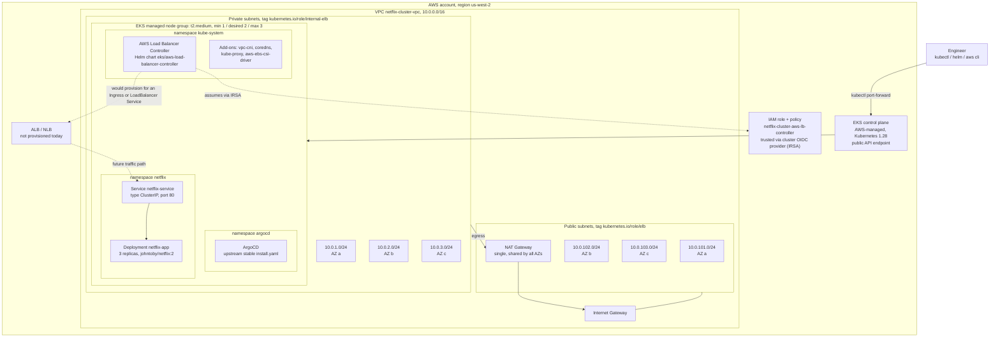
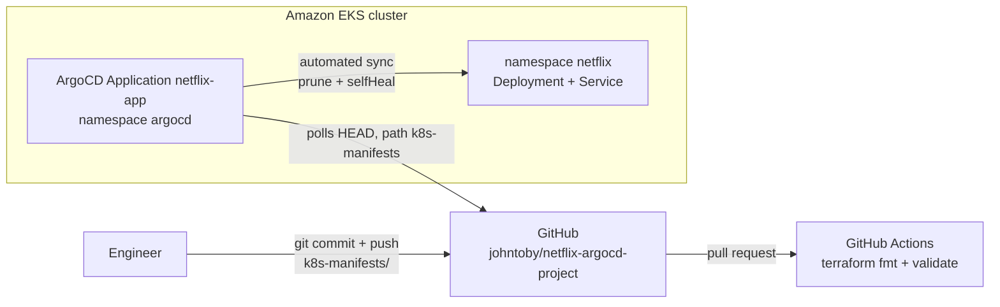

# Netflix Clone on Amazon EKS with ArgoCD

Terraform-provisioned Amazon EKS cluster with GitOps delivery through ArgoCD, and IRSA wired up for the AWS Load Balancer Controller.

[](https://github.com/johntoby/netflix-argocd-project/actions/workflows/terraform.yml)


[](LICENSE)

## Overview

This repository deploys a containerised Netflix-style web front end (`johntoby/netflix:2`) to Amazon EKS. It demonstrates:

- **Infrastructure as Code.** Terraform builds the VPC, the EKS cluster and a managed node group with the community `terraform-aws-modules`, plus the IAM role and policy the AWS Load Balancer Controller needs.
- **IRSA (IAM Roles for Service Accounts).** The controller's IAM role trusts the cluster's OIDC provider and only the `kube-system/aws-load-balancer-controller` service account, so no node-wide AWS credentials are handed to pods.
- **GitOps with ArgoCD.** ArgoCD runs inside the cluster and continuously reconciles `k8s-manifests/` from this repository, with automated sync, pruning and self-healing.
- **Automation.** `scripts/deploy.sh` does a full bootstrap (Terraform, kubeconfig, Load Balancer Controller via Helm, ArgoCD, Application). `scripts/cleanup.sh` tears it all down.
- **CI.** A GitHub Actions workflow runs `terraform fmt -check` and `terraform validate` on every pull request.

## Architecture

### AWS infrastructure

Defaults from `terraform/variables.tf` (region `us-west-2`). Solid lines are resources that exist after a deploy. The dashed load balancer is **not** created by the current manifests (see the note below the diagram).



> **What is and is not exposed.** `k8s-manifests/service.yaml` declares `type: ClusterIP` and there is no Ingress, so the app is reachable only through `kubectl port-forward` today. The AWS Load Balancer Controller is installed with Helm by `deploy.sh` and has working IRSA permissions, so adding an `Ingress` (ALB) or a `LoadBalancer` Service (NLB) is the next step (see [Roadmap](#roadmap--production-next-steps)).

### GitOps delivery flow



ArgoCD pulls from Git; nothing outside the cluster pushes to it, so no cluster credentials are stored in CI. The Application is defined in `argocd/application.yaml` and applied once by `deploy.sh`.

## Tech stack

| Layer | Tool | Where |
|---|---|---|
| Cloud | AWS (VPC, EKS, IAM, EC2) | `terraform/` |
| IaC | Terraform >= 1.3.2, AWS provider ~> 5.0 | `terraform/providers.tf` |
| Modules | `terraform-aws-modules/vpc/aws` ~> 5.0, `terraform-aws-modules/eks/aws` ~> 20.0 | `terraform/main.tf` |
| Orchestration | Amazon EKS (Kubernetes 1.28 by default), managed node group | `terraform/main.tf` |
| Ingress controller | AWS Load Balancer Controller (Helm), IRSA | `scripts/deploy.sh`, `terraform/main.tf` |
| GitOps | Argo CD (upstream `stable` manifests) | `argocd/application.yaml` |
| Workload | `johntoby/netflix:2`, 3 replicas | `k8s-manifests/` |
| CI | GitHub Actions + `hashicorp/setup-terraform` | `.github/workflows/terraform.yml` |

## Repository structure

```
.
├── .github/workflows/terraform.yml  # CI: terraform fmt -check + validate
├── argocd/
│   └── application.yaml             # ArgoCD Application -> k8s-manifests/
├── k8s-manifests/                   # Desired state synced by ArgoCD
│   ├── namespace.yaml
│   ├── deployment.yaml
│   └── service.yaml
├── scripts/
│   ├── deploy.sh                    # End-to-end bootstrap
│   └── cleanup.sh                   # End-to-end teardown
└── terraform/
    ├── providers.tf                 # Terraform + AWS provider
    ├── variables.tf                 # Region, CIDRs, node sizing, versions
    ├── main.tf                      # VPC, EKS, LB controller IAM (IRSA)
    └── outputs.tf
```

## Prerequisites

- An AWS account and credentials with permission to create VPC, EKS, EC2 and IAM resources (`aws sts get-caller-identity` should succeed)
- [Terraform](https://developer.hashicorp.com/terraform/install) >= 1.3.2
- [AWS CLI v2](https://docs.aws.amazon.com/cli/latest/userguide/getting-started-install.html)
- [kubectl](https://kubernetes.io/docs/tasks/tools/)
- [Helm 3](https://helm.sh/docs/intro/install/)
- bash (Linux, macOS, WSL or Git Bash)

## Deploy

> This creates billable AWS resources. See [Cost estimate](#cost-estimate).

### Option A: one command

```bash
git clone https://github.com/johntoby/netflix-argocd-project.git
cd netflix-argocd-project
./scripts/deploy.sh
```

The script:

1. Adds the `eks` Helm repo, then runs `terraform init` and `terraform apply -auto-approve` in `terraform/`.
2. Runs `aws eks update-kubeconfig` using the `cluster_name` and `region` outputs.
3. Installs or upgrades the AWS Load Balancer Controller with Helm, annotating its service account with the `aws_lb_controller_role_arn` output (IRSA).
4. Installs ArgoCD into the `argocd` namespace and waits for `argocd-server`.
5. Prints the initial ArgoCD admin password and starts a port-forward to `https://localhost:8080`.
6. Applies `argocd/application.yaml`. ArgoCD then syncs `k8s-manifests/`.

The script keeps running to hold the port-forward open. Press Ctrl+C to stop it.

### Option B: step by step

```bash
# 1. Infrastructure
cd terraform
terraform init
terraform plan -out tfplan
terraform apply tfplan

# 2. kubeconfig
aws eks update-kubeconfig \
  --region "$(terraform output -raw region)" \
  --name "$(terraform output -raw cluster_name)"

# 3. AWS Load Balancer Controller (IRSA)
helm repo add eks https://aws.github.io/eks-charts && helm repo update
helm upgrade --install aws-load-balancer-controller eks/aws-load-balancer-controller \
  -n kube-system \
  --set clusterName="$(terraform output -raw cluster_name)" \
  --set serviceAccount.create=true \
  --set serviceAccount.name=aws-load-balancer-controller \
  --set serviceAccount.annotations."eks\.amazonaws\.com/role-arn"="$(terraform output -raw aws_lb_controller_role_arn)"
cd ..

# 4. ArgoCD
kubectl create namespace argocd
kubectl apply -n argocd -f https://raw.githubusercontent.com/argoproj/argo-cd/stable/manifests/install.yaml
kubectl wait --for=condition=available --timeout=300s deployment/argocd-server -n argocd

# 5. Application
kubectl apply -f argocd/application.yaml
```

### Configuration

All inputs live in `terraform/variables.tf`. Override them with `-var` flags or a `terraform.tfvars` file (git-ignored).

| Variable | Default | Purpose |
|---|---|---|
| `aws_region` | `us-west-2` | Region; AZs are `<region>a/b/c` |
| `cluster_name` | `netflix-cluster` | EKS cluster name and resource name prefix |
| `cluster_version` | `1.28` | Kubernetes version (see [Known issues](#known-issues)) |
| `vpc_cidr` | `10.0.0.0/16` | VPC CIDR |
| `private_subnets` | `10.0.1.0/24`, `10.0.2.0/24`, `10.0.3.0/24` | Node subnets |
| `public_subnets` | `10.0.101.0/24`, `10.0.102.0/24`, `10.0.103.0/24` | NAT and internet-facing load balancers |
| `instance_types` | `["t2.medium"]` | Node instance types |
| `min_size` / `desired_size` / `max_size` | `1` / `2` / `3` | Node group size |

Example: `terraform apply -var 'cluster_name=demo' -var 'aws_region=eu-west-1'`.

If you fork the repo, change `repoURL` in `argocd/application.yaml` to your fork so ArgoCD watches your manifests.

## Access ArgoCD and the app

```bash
# ArgoCD admin password
kubectl -n argocd get secret argocd-initial-admin-secret \
  -o jsonpath='{.data.password}' | base64 -d; echo

# ArgoCD UI at https://localhost:8080 (user: admin; self-signed certificate)
kubectl port-forward svc/argocd-server -n argocd 8080:443

# Sync status
kubectl get applications -n argocd

# The app (ClusterIP service) at http://localhost:8081
kubectl port-forward svc/netflix-service -n netflix 8081:80
```

## Teardown

```bash
./scripts/cleanup.sh
```

This deletes the ArgoCD Application, the `netflix` and `argocd` namespaces, then runs `terraform destroy -auto-approve`. Check the EC2 console afterwards for leftover load balancers or ENIs if you added an Ingress or a `LoadBalancer` Service.

## Cost estimate

**Approximate**, on-demand pricing in `us-west-2` with the default variables. Verify with the [AWS Pricing Calculator](https://calculator.aws/) before deploying.

| Item | Rate | Note |
|---|---|---|
| EKS control plane | ~$0.10/hr | Standard support. Versions in extended support cost ~$0.60/hr |
| 2 x t2.medium nodes | ~$0.09/hr | ~$0.046/hr each, plus a small EBS root volume per node |
| NAT Gateway (1) | ~$0.045/hr | Plus ~$0.045/GB processed |
| Load balancer | $0 today | An ALB adds ~$0.0225/hr plus LCU charges once you add an Ingress |
| **Total** | **~$0.24/hr (~$175/month)** | Excludes data transfer. Tear down when you are done |

## Design decisions and trade-offs

- **Community Terraform modules** (`terraform-aws-modules/vpc` and `/eks`) instead of hand-written resources: battle-tested defaults and less code, at the cost of an extra abstraction layer and major-version upgrades to track.
- **Nodes in private subnets, single NAT gateway.** Nodes have no public IPs. One NAT gateway saves roughly $65/month compared with one per AZ, but it is a single point of failure for egress if that AZ fails.
- **Public EKS API endpoint** for easy access from a laptop and CI. Simple, but it widens the attack surface. See Security below.
- **ArgoCD pull model.** The cluster pulls from Git, so CI never holds cluster credentials, and `selfHeal` reverts manual drift.
- **Load Balancer Controller via Helm in a script, IAM via Terraform.** This keeps Terraform free of the Kubernetes and Helm providers (no provider-to-cluster dependency during plan), at the cost of two tools owning the bootstrap.
- **Local Terraform state.** Fine for a demo. A team setup needs a remote backend (S3 with DynamoDB or S3 native locking).
- **`t2.medium` nodes.** Cheap, but burstable and an older generation; the pod limit per node (17 with the VPC CNI) leaves little headroom after ArgoCD and the system add-ons.

## Security considerations

What is in place:

- **IRSA.** The Load Balancer Controller's role can only be assumed by `system:serviceaccount:kube-system:aws-load-balancer-controller` with audience `sts.amazonaws.com`.
- **Private worker nodes.** Nodes sit in private subnets with egress through NAT. The EKS module enforces IMDSv2 on the node group.
- **EKS access entries.** Only the identity that ran Terraform gets cluster-admin (`enable_cluster_creator_admin_permissions`).
- **No secrets in Git.** `.gitignore` excludes state files, `*.tfvars` and kubeconfigs, and the ArgoCD admin password is read from the cluster at runtime.

What I would harden for production:

- **Tighten the controller policy.** `terraform/main.tf` grants its actions on `Resource: *` without the tag conditions (`elbv2.k8s.aws/cluster`) used in the [upstream reference policy](https://github.com/kubernetes-sigs/aws-load-balancer-controller/blob/main/docs/install/iam_policy.json). Use the upstream JSON pinned to the chart version.
- **Restrict or disable the public API endpoint** (`cluster_endpoint_public_access_cidrs`, or private-only access through a VPN or bastion).
- **Secure ArgoCD.** Rotate and delete `argocd-initial-admin-secret`, configure SSO, use a dedicated AppProject instead of `default`, and pin the install manifest to a released version instead of `stable`.
- **Harden the pods.** Add a `securityContext` (non-root, read-only root filesystem, dropped capabilities), NetworkPolicies, and an image pinned by digest.
- **Pin and scan.** Pin the Helm chart version, scan images (Trivy) and Terraform (tfsec or Checkov) in CI.
- **Encrypt secrets.** Enable KMS envelope encryption for Kubernetes Secrets.

## Known issues

- **Kubernetes 1.28 is past end of EKS support.** New clusters on that version may be rejected or billed at the extended-support rate. Set `cluster_version` to a currently supported version (`aws eks describe-cluster-versions`). The EKS module v20 defaults managed nodes to Amazon Linux 2 AMIs, which are not published for Kubernetes 1.33+, so for those versions also set `ami_type = "AL2023_x86_64_STANDARD"` on the node group.
- **The `aws-ebs-csi-driver` add-on has no IRSA role,** and nothing in this repo uses persistent volumes. Give it a role (the AWS-managed `AmazonEBSCSIDriverPolicy`) or remove the add-on.
- **The Helm chart is unpinned.** `deploy.sh` installs the latest controller chart, which may need IAM actions missing from the inline policy. Pin the chart version and match its policy.

## Roadmap / production next steps

- [ ] Expose the app through an `Ingress` (ALB) with ACM TLS and an ExternalDNS-managed hostname
- [ ] Remote Terraform state (S3 + locking) and a `terraform plan` job in CI using GitHub OIDC (no static keys)
- [ ] ArgoCD app-of-apps (or ApplicationSets) managing ArgoCD, the LB controller and the workload declaratively, replacing the imperative steps in `deploy.sh`
- [ ] Readiness and liveness probes, PodDisruptionBudget, HorizontalPodAutoscaler, and Cluster Autoscaler or Karpenter for nodes
- [ ] Observability: Prometheus and Grafana (or CloudWatch Container Insights), plus SLO-based alerts
- [ ] Separate dev, staging and prod environments with Kustomize overlays or Helm values
- [ ] Image build pipeline that bumps the image tag in Git (for example Argo CD Image Updater)

## License

[MIT](LICENSE) © 2025 John Idowu
